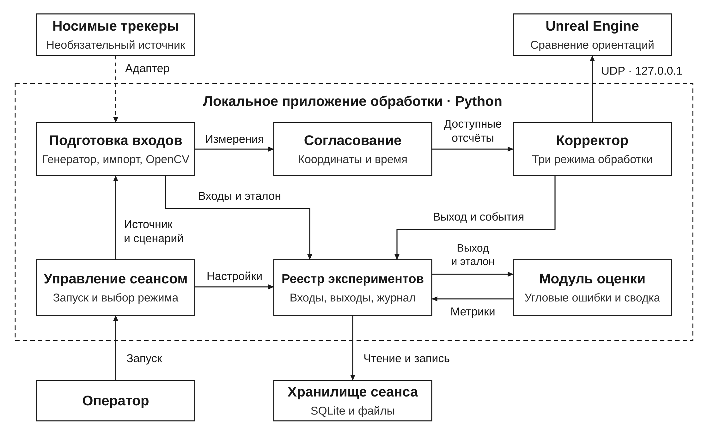
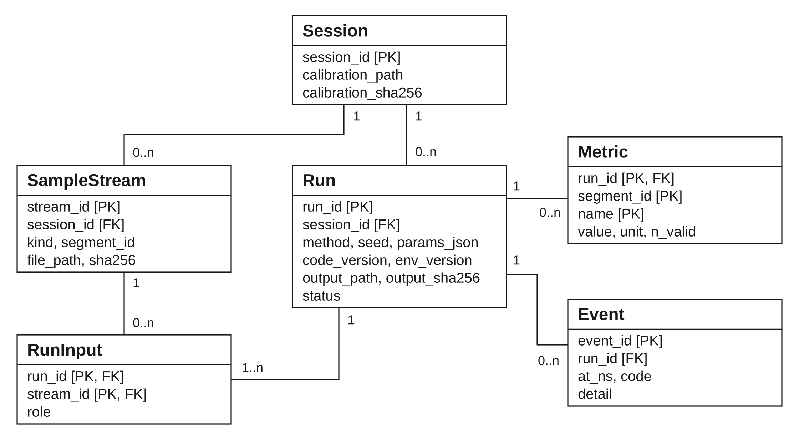
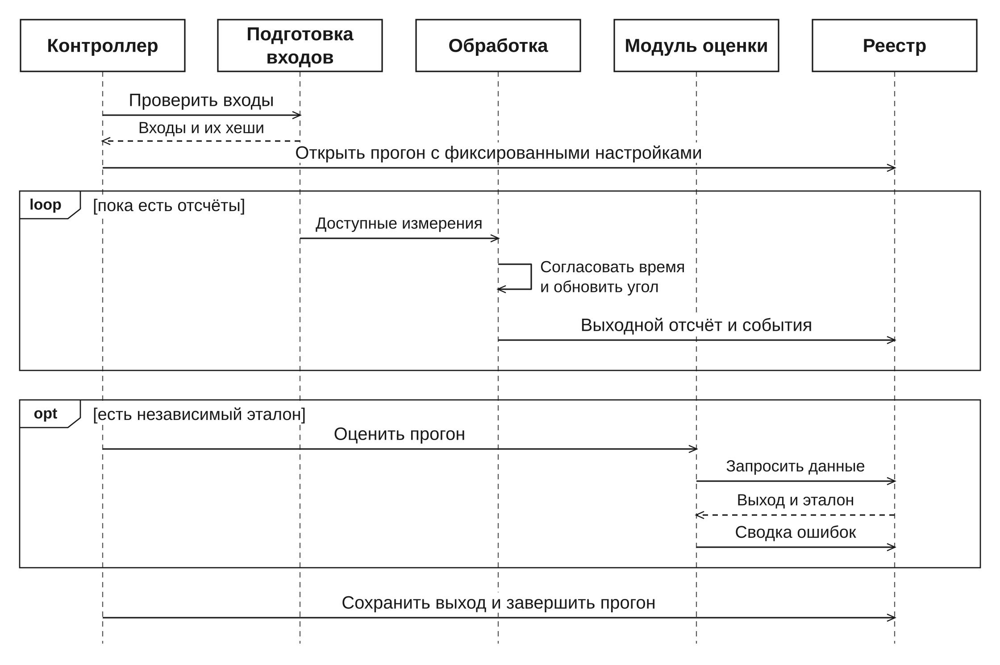
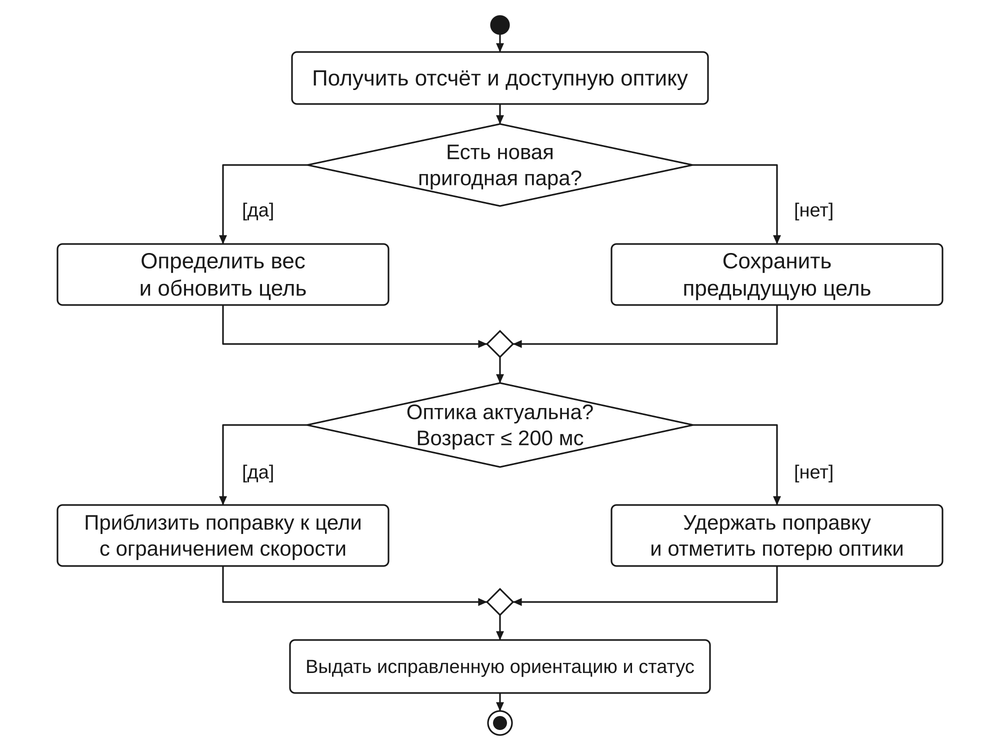
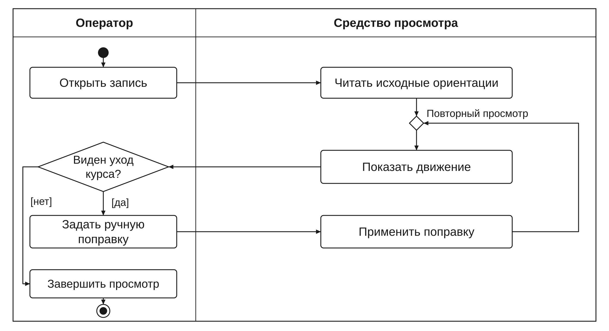
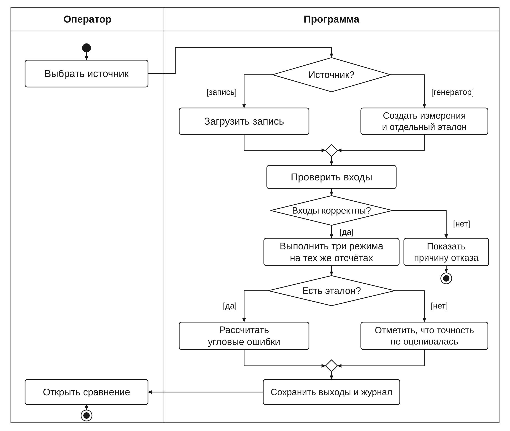

# ЛР 3 — проектирование

**Тема ВКР:** Разработка программной системы компенсации дрейфа ориентации при захвате движений с использованием оптических измерений.

**Автор или участники команды:** Макаров Максим Вячеславович, 412999. Работа индивидуальная.

**Вклад каждого участника при командной работе:** Не применяется.

## 1. Предметная область и требования

### Описание предметной области

При инерциальном захвате движений ориентация со временем отклоняется от истинной. Например, объект вернулся в исходное положение, а в Unreal Engine остался повёрнутым. Камера даёт опору для поправки курса, но маркер может выйти из кадра, а наблюдение — запоздать.

Разработчик выбирает источник, запускает разные режимы коррекции на одних данных и сравнивает исходное и исправленное движение. Первый объект проверки — один жёсткий сегмент. Для основного эксперимента достаточно моделируемых данных или записи; при наличии трекеров данные можно получить через отдельный адаптер.

### Функциональные требования

| ID | Требование | Как проверить выполнение |
|---|---|---|
| FR-01 | Создать сеанс и выбрать генератор или запись. | Выполнить оба сценария на ПК без подключённых трекеров. |
| FR-02 | Подготовить эталон и отдельные наблюдения с заданными дрейфом, шумом, задержкой и пропусками. | Повторить генерацию с тем же seed. Сверить отсчёты и моменты пропусков. |
| FR-03 | Проверить формат, временные метки и калибровку до запуска. | Подать запись с нулевым кватернионом или неверной калибровкой. Получить причину отказа. |
| FR-04 | Получить поворот маркера из видео или готовой записи. Согласовать базис и время измерений. | Подать запись с известным поворотом и задержкой. Сверить восстановленный поворот и временную пару. |
| FR-05 | Обработать один вход без коррекции, с постоянным весом оптики и с весом по качеству наблюдения. | Сравнить три выхода, в том числе после пропуска, ложного наблюдения и возвращения маркера. |
| FR-06 | Показать в Unreal Engine исходную и исправленную ориентации и статус оптики. | Сверить отображаемые ориентации для одного сегмента и номера отсчёта. |
| FR-07 | Сохранить входы, параметры, выходной файл и журнал каждого прогона. | Открыть сохранённый прогон и найти использованные данные, выход и причины пропусков. |
| FR-08 | При наличии эталона рассчитать угловые ошибки и сравнить режимы. | Сверить результат на известном повороте. Без эталона вывести «нет оценки точности». |

### Нефункциональные требования

Пороги ниже задают условия контрольного испытания будущей реализации.

| ID | Требование | Как проверить выполнение |
|---|---|---|
| NFR-01 | Для 10 потоков по 120 Гц 95-й процентиль времени шага ядра должен быть не выше 5 мс на ПК с i7-14700K. | После 1000 шагов прогрева замерить 10 000 шагов. Исключить детектор видео, запись и рендеринг. |
| NFR-02 | Повторять угловые метрики в одной программной среде при тех же входах, seed и настройках. | Дважды провести испытание. Допуск расхождения метрик — 0,000001 рад. |
| NFR-03 | Проверять контрольные суммы входов и калибровки. Отмечать прогон завершённым только после записи выхода и сводки. | Изменить входной файл; отдельно прервать запись выхода. Ни один прогон не должен получить статус «завершён». |
| NFR-04 | Не использовать ещё не поступившие отсчёты. Хранить до 500 мс истории, принимать оптику не старше 200 мс, ограничивать скорость поправки до 30°/с в контрольном профиле. | Подать запоздавший кадр и перекрыть маркер на 10 с. Сверить журнал, буфер и предел изменения поправки. |
| NFR-05 | Выполнять основной сценарий локально. Файлы сеанса читать из его каталога, позы в Unreal отправлять через 127.0.0.1. | Провести прогон без интернета и проверить, что относительный путь за пределы каталога отклоняется. |
| NFR-06 | Подключать источники через общий интерфейс. | Отключить адаптер устройства и запустить генератор и воспроизведение без изменения корректора. |

## 2. Обзор нотаций и видов диаграмм

| Нотация или вид диаграммы | Что описывает | Сильные стороны |
|---|---|---|
| BPMN | Процесс, события, участников и сообщения. | Показывает передачу работы между ролями и действия при исключениях. |
| IDEF0 | Функции, входы, выходы, управление и механизмы. | Позволяет разложить функцию на части и выяснить, какие ресурсы ей нужны. |
| ER-модель | Сущности, поля, ключи и кратности связей. | Выявляет дублирование данных и неоднозначные связи до создания БД. |
| UML: варианты использования | Действия пользователя и границы системы. | Помогает согласовать набор возможностей до проектирования интерфейса. |
| UML: классы | Атрибуты, операции и отношения типов. | Удобна для определения обязанностей классов и интерфейсов. |
| UML: последовательности | Сообщения между участниками по времени. | Показывает, кто вызывает обработку и когда другой компонент получает результат. |
| UML: активности | Действия, условия и альтернативные пути. | Позволяет проследить работу процесса при разных входах, включая ошибки. |
| UML: состояния | Состояния объекта и события переходов. | Удобна для описания жизненного цикла сеанса или прогона. |
| C4: компоненты | Устройство одного приложения и его связи с окружением. | Показывает обязанности частей программы и направление обмена данными. |

Источники нотаций: [OMG UML 2.5.1](https://www.omg.org/spec/UML/2.5.1), [OMG BPMN 2.0.2](https://www.omg.org/spec/BPMN/2.0.2), [FIPS PUB 183 IDEF0](https://nvlpubs.nist.gov/nistpubs/Legacy/FIPS/fipspub183.pdf), [C4: Component diagram](https://c4model.com/diagrams/component).

## 3. Выбор нотаций для проекта

| Нотация или вид диаграммы | Что моделируем | Связанные требования | Почему подходит |
|---|---|---|---|
| C4: компоненты | Границу приложения и потоки данных между модулями. | FR-01, FR-04, FR-06, FR-07; NFR-01, NFR-05, NFR-06 | Видно, где заменить источник и как отделить визуализацию от вычислений. |
| ER-модель | Хранение сеансов, записей, прогонов, метрик и событий. | FR-02, FR-07, FR-08; NFR-02, NFR-03 | От каждого результата можно перейти к входам и настройкам. |
| UML: последовательности | Прогон от проверки входов до сохранения результата. | FR-03, FR-04, FR-05, FR-07, FR-08; NFR-02, NFR-03, NFR-04 | Видно, когда доступны измерения и кто читает эталон. |
| UML: активности | Правила обновления поправки и рабочий процесс оператора. | FR-01–FR-05, FR-07, FR-08; NFR-04, NFR-06 | Ветви показывают поведение при пропусках, отказе проверки и отсутствии эталона. |

## 4. Модели системы

### Диаграмма компонентов C4

**Диаграмма:**

**Пояснение модели:** «Подготовка входов» читает запись, генерирует тестовые данные или принимает выход адаптера устройства. Этот же модуль извлекает позу маркера из видео средствами [OpenCV](https://docs.opencv.org/4.x/d5/dae/tutorial_aruco_detection.html). В корректор через согласование идут только измерения. Эталон записывается отдельно; из хранилища его читает модуль оценки после обработки.

**Отражённые функциональные требования и элементы модели:** Подготовка входов реализует FR-01–FR-03, согласование и корректор — FR-04 и FR-05. Unreal получает пару «до / после» со статусом (FR-06). Реестр и модуль оценки обеспечивают FR-07 и FR-08.

**Нефункциональные требования и проектные решения:** Смена источника происходит до согласования (NFR-06). Ядро работает независимо от визуализации и файлового вывода (NFR-01). Реестр хранит данные в SQLite и файлах сеанса. Визуализация получает пакеты UDP по локальному адресу 127.0.0.1 (NFR-05). Потерянный пакет не влияет на выходной файл и метрики.

В записи отсчёта указываются сегмент, время измерения, время доступности и кватернион X, Y, Z, W. Калибровка задаёт параметры камеры и её положение, а также поворот маркера относительно сегмента. Для синтетического видео они известны из сценария. Адаптер Unreal выполняет преобразование базиса перед отображением.

### ER-модель реестра экспериментов

**Диаграмма:**

**Пояснение модели:** Session хранит данные сеанса и версию калибровки. SampleStream описывает входную запись, Run — выполнение одного режима, RunInput связывает прогон с потоками в ролях «ориентация», «оптика» и «эталон». Выход прогона сохраняется в JSONL и доступен по Run.output_path. Metric хранит показатели по сегментам, Event — причины отклонения наблюдений и сбои.

**Отражённые функциональные требования и элементы модели:** При сравнении трёх режимов создаются три Run с одинаковыми наборами входов. По RunInput и параметрам можно повторить сценарий (FR-02, FR-05, FR-07). Если эталона нет, угловые метрики отсутствуют; это фиксируется событием, поэтому отсутствие оценки не выглядит как нулевая ошибка (FR-08).

**Нефункциональные требования и проектные решения:** Сохраняются seed, версии кода и среды и контрольные суммы файлов (NFR-02, NFR-03). В SQLite действуют [внешние ключи](https://www.sqlite.org/foreignkeys.html); перед добавлением связи проверяется принадлежность входа и прогона одному сеансу. Выход сначала записывается во временный файл. После его сохранения имя файла, хеш, сводка и итоговый статус фиксируются в транзакции БД. При восстановлении незавершённый прогон помечается прерванным.

### Диаграмма последовательностей UML

**Диаграмма:**

**Пояснение модели:** После проверки входов контроллер открывает прогон. Измерения выдаются по времени доступности. «Обработка» на схеме объединяет вызовы согласования и корректора с рисунка 1. Исправленные отсчёты сохраняются в выходной файл. Когда обработка закончена, модуль оценки читает выход и отдельный эталон, если тот есть.

**Отражённые функциональные требования и элементы модели:** Проверка входов выполняется до прогона (FR-03). Цикл охватывает согласование и коррекцию (FR-04, FR-05). Реестр записывает выход и события (FR-07); условный блок содержит расчёт точности (FR-08). Перед завершением прогона фиксируется, доступна ли оценка.

**Нефункциональные требования и проектные решения:** Настройки и список входов фиксируются при открытии Run (NFR-02). Оптический отсчёт с моментом измерения t сопоставляется только с уже поступившими ориентациями из буфера. Если пары ещё нет, кадр может ждать в пределах срока годности; затем его отклоняют (NFR-04). Реестр отмечает завершение после сохранения результатов (NFR-03).

### Диаграмма активности UML для корректора

**Диаграмма:**

**Пояснение модели:** Для новой допустимой оптической позы вычисляется относительный поворот между наблюдением и входной ориентацией того же сегмента в тот же момент. Из него выделяется поворот вокруг вертикали. Целевой угол поправки обновляется по кратчайшей дуге с заданным весом. В одном режиме вес постоянный, в другом он зависит от ошибки репроекции, размера маркера и давности наблюдения. В режиме без коррекции входная ориентация передаётся без изменения.

**Отражённые функциональные требования и элементы модели:** Первое условие проверяет наличие пригодной пары измерений (FR-04). Второе решает, продолжать ли плавное применение уже рассчитанной поправки или удерживать её (FR-05). Выходной статус используется для показа в Unreal и записи событий (FR-06, FR-07).

**Нефункциональные требования и проектные решения:** Общие правила отбраковки применяются в обоих режимах с оптикой. Каждый кадр камеры может обновить цель один раз. Между кадрами применяемая поправка приближается к цели с ограничением скорости. Если с момента измерения последней принятой оптической позы прошло больше 200 мс, применяемая поправка удерживается (NFR-04). После возвращения ориентира она обновляется плавно, без сброса.

## 5. AS-IS и TO-BE

**Выбранная нотация:** UML, диаграммы активности с дорожками оператора и программы.

### AS-IS — текущее состояние

**Диаграмма:**

**Описание и ограничения:** Базовый процесс для сравнения — просмотр записи с дрейфом. Если оператор замечает уход курса, он задаёт поправку и просматривает запись снова. В этом сценарии решение о поправке принимается по изображению, а параметры и ошибки прогонов отдельно не сохраняются.

### TO-BE — предлагаемое состояние

**Диаграмма:**

**Описание изменений:** Оператор выбирает запись или генератор. Программа проверяет входы, выполняет три режима на одном наборе и сохраняет выходы и журнал. При наличии независимого эталона в сводку добавляются угловые ошибки; без него сохраняются выходы и отметка о недоступности оценки точности.

### Обоснование перехода

В TO-BE три режима обрабатывают один набор отсчётов, а список входов в RunInput позволяет повторить эксперимент. Если записи нет, генератор создаёт входы с заданными дрейфом, шумом и пропусками. Отдельная эталонная траектория позволяет измерить ошибку без трекеров.

## 6. Выводы

Модели связывают один режим с одним прогоном, а эталон — только с оценкой. Сначала нужно реализовать формат записи и генератор, затем согласование и корректор. На контрольных прогонах проверяются угловая ошибка, время восстановления, скорость поправки и время вычисления. Испытания на реальных трекерах нужны отдельно, чтобы проверить перенос результата на оборудование.
